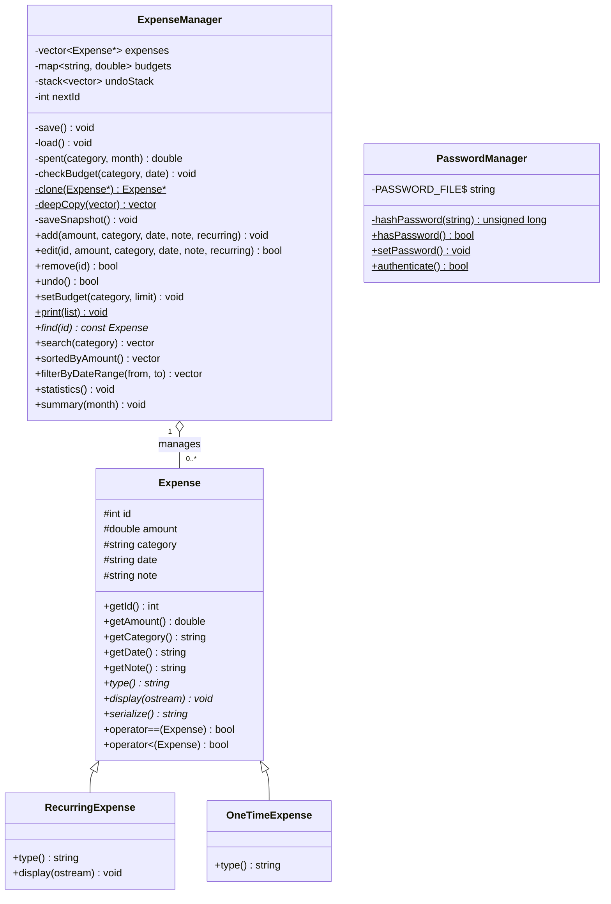
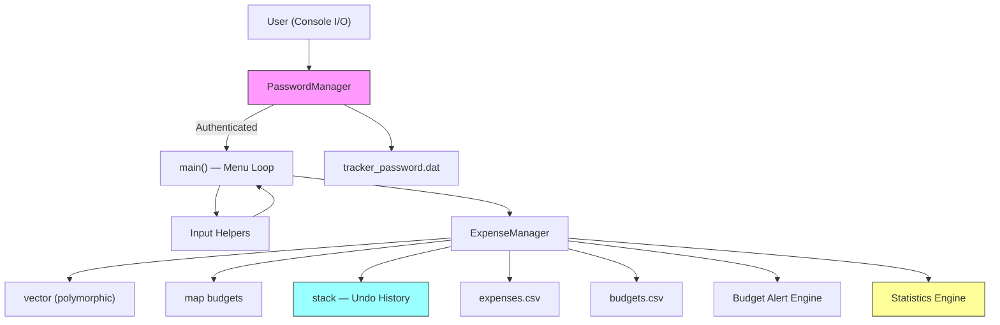
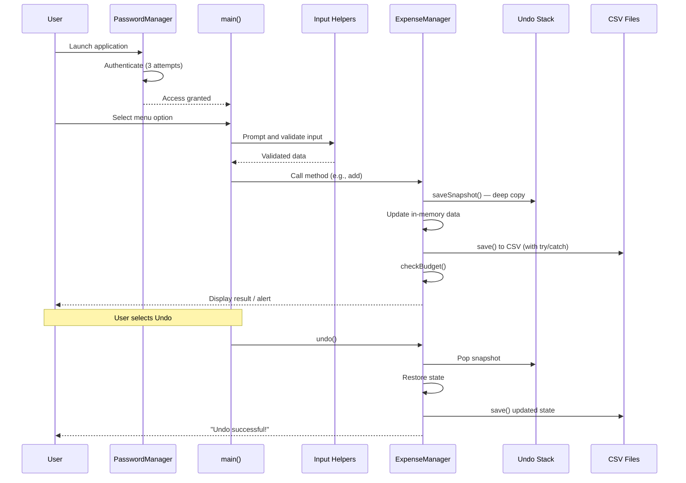
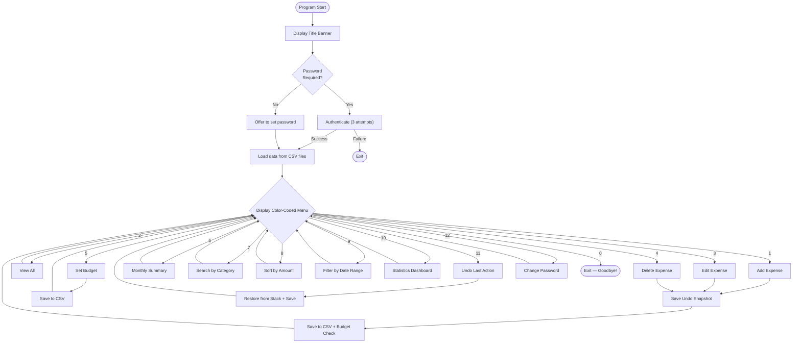

# Project Report: Expenditure and Budget Tracker

> **Subject:** Object-Oriented Programming (OOP)  
> **Semester:** 3rd Semester  
> **Language:** C++ (Standard: C++17)  
> **Date:** November 2026

---

## 1. Introduction

Managing personal finances is an essential life skill, yet many individuals struggle to track daily expenses and adhere to monthly budgets. The **Expenditure and Budget Tracker** is a console-based C++ application that enables users to record, categorize, and analyze their spending. It provides real-time budget alerts, persistent CSV storage, undo capability, a statistics dashboard, password protection, and color-coded output — making it a practical tool for personal financial management.

### 1.1 Objective

- To develop a fully featured expense-tracking system showcasing core and advanced OOP principles in C++.
- To allow users to add, edit, delete, search, sort, and filter expenses by category, amount, and date range.
- To support per-category monthly budgets with automatic warning and alert notifications.
- To persist all data across sessions using CSV file I/O with robust exception handling.
- To demonstrate inheritance, polymorphism, operator overloading, and encapsulation in a real-world application.

### 1.2 Scope

The application is designed as a single-user, offline, console-based program. It stores data locally in CSV files (`expenses.csv`, `budgets.csv`) and an optional password file (`tracker_password.dat`), requiring no database or network connectivity.

---

## 2. Object-Oriented Design

The program demonstrates the following OOP concepts:

### 2.1 Classes and Encapsulation

| Class | Role |
|---|---|
| **`Expense`** | Base class representing a general expense with `id`, `amount`, `category`, `date`, and `note`. All data members are `protected`, accessed through getters/setters. |
| **`RecurringExpense`** | Derived class for recurring expenses (rent, subscriptions). Overrides `type()` and `display()`. |
| **`OneTimeExpense`** | Derived class for one-time expenses. Overrides `type()`. |
| **`ExpenseManager`** | Controller class: owns the polymorphic collection, budgets, undo stack, and handles all business logic and file persistence. |
| **`PasswordManager`** | Handles password hashing, storage, and authentication with attempt limiting. |
| **`Color`** (namespace) | Provides ANSI color constants for console output. |

### 2.2 Inheritance



The **`Expense`** base class defines the common interface. **`RecurringExpense`** and **`OneTimeExpense`** inherit from it and override virtual methods, demonstrating **IS-A** relationships.

### 2.3 Polymorphism

The program uses **runtime polymorphism** through virtual functions:

| Virtual Method | Base Behavior | Override Behavior |
|---|---|---|
| `type()` | Returns `"General"` | `RecurringExpense` → `"Recurring"`, `OneTimeExpense` → `"One-time"` |
| `display()` | Prints expense in standard format | `RecurringExpense` adds cyan color highlighting |
| `serialize()` | Writes CSV with type field | Inherited — uses `type()` polymorphically |

`ExpenseManager` stores `vector<Expense*>` (base-class pointers), so calling `e->display()` or `e->type()` on any pointer invokes the correct derived-class method at runtime.

### 2.4 Operator Overloading

| Operator | Purpose |
|---|---|
| `operator<<` (friend) | Enables `cout << expense;` — calls the virtual `display()` method, supporting polymorphic output. |
| `operator==` | Compares two expenses by ID — enables `find` and equality checks. |
| `operator<` | Compares by amount (descending) — enables `sort()` using `*a < *b`. |

### 2.5 Encapsulation & Data Hiding

All data members of `Expense` are `protected` (accessible to derived classes but not external code). All data members and helper methods of `ExpenseManager` are `private`. The `public` interface serves as the only controlled access point:

- **Private helpers:** `save()`, `load()`, `spent()`, `checkBudget()`, `saveSnapshot()`, `clone()`, `deepCopy()`, `freeAll()`
- **Public interface:** `add()`, `edit()`, `remove()`, `undo()`, `find()`, `search()`, `summary()`, `statistics()`, etc.

### 2.6 Abstraction

The user-facing menu (in `main()`) calls high-level methods such as `manager.add(...)` and `manager.statistics()` without any knowledge of the internal data structures, file formats, or memory management.

### 2.7 Exception Handling

All file I/O and string-to-number conversions are wrapped in `try/catch` blocks:

- **`save()`** — catches and reports file write failures gracefully instead of crashing.
- **`load()`** — catches corrupted CSV data (bad `stoi`/`stod`) and starts fresh with a warning.
- **`validDate()`** — catches parsing errors and returns `false`.
- **`askAmountOrKeep()`** — catches invalid numeric input gracefully.

### 2.8 Use of STL Containers

| Container | Usage |
|---|---|
| `vector<Expense*>` | Polymorphic collection of all expenses; supports dynamic resizing, iteration, and erasure. |
| `map<string, double>` | Stores per-category budget limits; O(log n) lookup. |
| `stack<vector<Expense*>>` | Undo history — stores deep-copied snapshots of the expense list. |

---

## 3. System Architecture



### 3.1 Component Breakdown

1. **Password Gate (`PasswordManager`)** — On first run, optionally sets a password. On subsequent runs, authenticates with 3 attempts.
2. **Menu Loop (`main`)** — Displays a color-coded, 12-option interactive menu and dispatches to `ExpenseManager` methods.
3. **Input Helpers** — Standalone validation functions (`askAmount`, `askDate`, `askCategory`, etc.) that ensure data integrity before it reaches the manager.
4. **ExpenseManager** — Central business-logic class: CRUD operations, undo, budget management, search, sort, date-range filtering, and statistics.
5. **File Persistence Layer** — `save()` and `load()` serialize/deserialize data to/from CSV with exception handling.
6. **Budget Alert Engine** — `checkBudget()` fires after every add/edit, comparing cumulative category spending against the stored limit.
7. **Statistics Engine** — `statistics()` computes totals, averages, extremes, and per-category breakdowns.
8. **Undo System** — `saveSnapshot()` deep-copies the current state before every mutation; `undo()` restores it.

---

## 4. Features

### 4.1 Add Expense (Option 1)
Prompts for amount, category, date, note, and whether the expense is recurring or one-time. Assigns an auto-incrementing ID, saves to disk, and triggers a budget check.

### 4.2 View All Expenses (Option 2)
Displays every recorded expense in a formatted, color-coded table (ID, Amount, Category, Date, Type, Note). Recurring expenses are highlighted in cyan.

### 4.3 Edit Expense (Option 3)
Finds an expense by ID, shows its current values, and allows modification. Pressing Enter retains the current value — a user-friendly "keep or change" pattern. Saves an undo snapshot before editing.

### 4.4 Delete Expense (Option 4)
Finds and displays the expense for confirmation. Removes only after a y/n prompt — preventing accidental data loss. Saves an undo snapshot before deletion.

### 4.5 Set Monthly Budget (Option 5)
Associates a spending limit with a category (e.g., Food → 5000). The limit is stored persistently and used for future alerts.

### 4.6 Monthly Summary (Option 6)
For a given month (YYYY-MM), aggregates spending by category and displays it alongside budget limits. Over-budget categories are highlighted in red; under-budget in green. Includes a grand total.

### 4.7 Search by Category (Option 7)
Filters and displays all expenses belonging to a given category.

### 4.8 Sort by Amount (Option 8)
Displays all expenses sorted in descending order of amount using the overloaded `operator<`.

### 4.9 Filter by Date Range (Option 9) *(New)*
Prompts for a start and end date, then displays all expenses falling within that range. Automatically swaps dates if entered in reverse order.

### 4.10 Statistics Dashboard (Option 10) *(New)*
Computes and displays:
- Total number of expenses
- Total amount spent
- Average spending per expense
- Highest and lowest single expense (with category)
- Most-spent category
- Per-category breakdown (total, count, average)

### 4.11 Undo Last Action (Option 11) *(New)*
Reverses the last add, edit, or delete operation by restoring a deep-copied snapshot from the undo stack. Supports up to 10 levels of undo.

### 4.12 Change Password (Option 12) *(New)*
Allows the user to set or change their password at any time. The password is stored as a hash in `tracker_password.dat`.

### 4.13 Budget Alerts (Automatic)
- **WARNING** (yellow) at ≥ 80% utilization
- **ALERT** (red) when the limit is exceeded

### 4.14 Color-Coded Output *(New)*
Uses ANSI escape codes throughout the application:
- **Red** — alerts, errors, over-budget markers
- **Green** — success messages, under-budget markers
- **Yellow** — warnings, new feature indicators
- **Cyan** — headers, banners, recurring expenses
- **White** — table headers, key statistics
- **Dim** — placeholders, hints

---

## 5. Data Flow



---

## 6. Input Validation

| Function | Validation Rule |
|---|---|
| `askAmount()` | Must be a positive number; rejects non-numeric and negative input. |
| `validDate()` | Enforces `YYYY-MM-DD` format with real calendar validation including leap years. Wrapped in `try/catch`. |
| `askCategory()` | Trims whitespace; enforces 1–20 characters; rejects commas (CSV safety); normalizes to Title Case. |
| `askId()` | Accepts only whole numbers (digits only), up to 9 digits. |
| `askYesNo()` | Accepts only `y` or `n`. |
| `askAmountOrKeep()` | Allows empty input (keep current) or a positive number. Uses `try/catch` for `stod`. |

---

## 7. File Formats

### `expenses.csv`

```
1,250.00,Food,2026-10-15,One-time,Dinner at restaurant
2,1200.00,Rent,2026-10-01,Recurring,October rent
```

Each row: `id,amount,category,date,type,note`

### `budgets.csv`

```
Food,5000.00
Rent,12000.00
```

Each row: `category,limit`

### `tracker_password.dat`

```
193485963
```

Contains a single DJB2 hash of the user's password.

---

## 8. Menu Flowchart



---

## 9. Sample Run

```
  ╔══════════════════════════════════════════════╗
  ║     EXPENDITURE  &  BUDGET  TRACKER         ║
  ║     Enhanced OOP Edition                     ║
  ╚══════════════════════════════════════════════╝

Would you like to set a password? (y/n): y
Set a password for the tracker: ****
Confirm password: ****
Password set successfully!

─── MENU ───────────────────────────────────
   1. Add expense          5. Set monthly budget     9. Filter by date range
   2. View all expenses    6. Monthly summary       10. Statistics dashboard
   3. Edit expense         7. Search by category    11. Undo last action
   4. Delete expense       8. Sort by amount        12. Change password
                           0. Exit
─────────────────────────────────────────────
Choice: 1
Amount: 1200
Category: Rent
Date (YYYY-MM-DD): 2026-10-01
Note: October apartment rent
Is this a recurring expense? (y/n): y
Expense #1 added.

Choice: 10

========== Statistics Dashboard ==========

  Total expenses recorded : 3
  Total amount spent      : 1950.00
  Average per expense     : 650.00
  Highest single expense  : 1200.00 (Rent)
  Lowest single expense   : 350.00 (Food)
  Most-spent category     : Rent (1200.00)
  Number of categories    : 2

  Category        Total         Count   Average
  --------------------------------------------------
  Food            750.00        2       375.00
  Rent            1200.00       1       1200.00

==========================================

Choice: 11
Undo successful!

Choice: 0
Goodbye! Happy saving!
```

---

## 10. Key OOP Concepts Demonstrated

| OOP Concept | Where It Appears |
|---|---|
| **Class & Object** | `Expense`, `RecurringExpense`, `OneTimeExpense`, `ExpenseManager`, `PasswordManager` — all instantiated and used. |
| **Inheritance** | `RecurringExpense` and `OneTimeExpense` inherit from `Expense` (IS-A relationship). |
| **Polymorphism** | Virtual functions `type()`, `display()`, `serialize()` — called through base-class pointers in `ExpenseManager`. |
| **Operator Overloading** | `operator<<` (stream insertion), `operator==` (equality by ID), `operator<` (comparison by amount). |
| **Encapsulation** | Private data + public interface in `ExpenseManager`; protected data + getters/setters in `Expense`. |
| **Abstraction** | `main()` uses high-level methods; internal storage, memory management, and file format are hidden. |
| **Data Hiding** | Private members: `expenses`, `budgets`, `undoStack`, `nextId`, `save()`, `load()`, `checkBudget()`, etc. |
| **Exception Handling** | `try/catch` blocks around file I/O, `stoi`, `stod`; graceful degradation on corrupted data. |
| **Static Members** | `ExpenseManager::print()`, `PasswordManager` methods, `Color` namespace constants. |
| **STL Usage** | `vector`, `map`, `stack`, `sort`, `swap`, `stringstream`, `ifstream`, `ofstream`. |
| **Lambda Expressions** | Used in `sortedByAmount()` and `remove()` for inline predicates. |
| **Dynamic Memory** | `new`/`delete` for polymorphic `Expense*` objects; proper cleanup in destructor and `undo()`. |
| **Namespaces** | `Color` namespace groups ANSI escape code constants. |
| **Destructor** | `ExpenseManager::~ExpenseManager()` frees all heap-allocated expenses and undo snapshots. |

---

## 11. Limitations

1. **Single-user only** — no multi-user support or user profiles.
2. **Hash is not cryptographic** — DJB2 is a simple hash; a real application would use bcrypt or similar.
3. **Comma restriction** — categories cannot contain commas (CSV delimiter conflict).
4. **Console-only** — no graphical user interface.
5. **No encryption** — CSV files are stored in plaintext on disk.
6. **ANSI color support** — requires a modern terminal; older Windows CMD may not render colors correctly.

---

## 13. Conclusion

The **Expenditure and Budget Tracker (Enhanced OOP Edition)** is a fully functional, console-based financial management tool built in C++17. It comprehensively demonstrates Object-Oriented Programming principles — **inheritance** (Expense hierarchy), **polymorphism** (virtual methods through base-class pointers), **operator overloading** (`<<`, `==`, `<`), **encapsulation** (private/protected access control), **abstraction** (clean public interfaces), and **exception handling** (`try/catch` for robust error recovery). Additional features including an undo system, statistics dashboard, date-range filtering, password protection, and color-coded output make it both a practical application and a thorough academic demonstration of OOP in C++.

---

## 14. Source Code

```cpp
// Expenditure and Budget Tracker - Enhanced OOP version (C++)
#include <algorithm>
#include <cctype>
#include <ctime>
#include <fstream>
#include <functional>
#include <iomanip>
#include <iostream>
#include <map>
#include <sstream>
#include <stack>
#include <stdexcept>
#include <vector>
using namespace std;

// ==================== ANSI Color Helpers ====================

namespace Color {
    const string RESET   = "\033[0m";
    const string RED     = "\033[1;31m";
    const string GREEN   = "\033[1;32m";
    const string YELLOW  = "\033[1;33m";
    const string BLUE    = "\033[1;34m";
    const string MAGENTA = "\033[1;35m";
    const string CYAN    = "\033[1;36m";
    const string WHITE   = "\033[1;37m";
    const string DIM     = "\033[2m";
}

// ==================== Base Expense class ====================

class Expense {
protected:
    int id;
    double amount;
    string category, date, note;   // date format: YYYY-MM-DD

public:
    Expense() : id(0), amount(0) {}
    Expense(int id, double amount, string category, string date, string note)
        : id(id), amount(amount), category(move(category)), date(move(date)), note(move(note)) {}
    virtual ~Expense() = default;

    // Getters
    int getId() const { return id; }
    double getAmount() const { return amount; }
    const string& getCategory() const { return category; }
    const string& getDate() const { return date; }
    const string& getNote() const { return note; }

    // Setters
    void setId(int i) { id = i; }
    void setAmount(double a) { amount = a; }
    void setCategory(const string& c) { category = c; }
    void setDate(const string& d) { date = d; }
    void setNote(const string& n) { note = n; }

    // Virtual method — polymorphism: subclasses override this
    virtual string type() const { return "General"; }

    // Virtual display — polymorphism
    virtual void display(ostream& os) const {
        os << left << setw(5)  << id
           << setw(12) << fixed << setprecision(2) << amount
           << setw(14) << category
           << setw(12) << date
           << setw(12) << type()
           << note;
    }

    // Virtual serialize/deserialize for CSV
    virtual string serialize() const {
        return to_string(id) + "," + to_string(amount) + "," + category + ","
               + date + "," + type() + "," + note;
    }

    // Operator overloading: << for printing
    friend ostream& operator<<(ostream& os, const Expense& e) {
        e.display(os);
        return os;
    }

    // Operator overloading: == for comparison
    bool operator==(const Expense& other) const { return id == other.id; }

    // Operator overloading: < for sorting by amount (descending)
    bool operator<(const Expense& other) const { return amount > other.amount; }
};

// ==================== Derived classes — Inheritance ====================

class RecurringExpense : public Expense {
public:
    RecurringExpense() = default;
    RecurringExpense(int id, double amount, string category, string date, string note)
        : Expense(id, amount, move(category), move(date), move(note)) {}

    string type() const override { return "Recurring"; }

    void display(ostream& os) const override {
        os << Color::CYAN;
        Expense::display(os);
        os << Color::RESET;
    }
};

class OneTimeExpense : public Expense {
public:
    OneTimeExpense() = default;
    OneTimeExpense(int id, double amount, string category, string date, string note)
        : Expense(id, amount, move(category), move(date), move(note)) {}

    string type() const override { return "One-time"; }
};

// ==================== Password Manager ====================

class PasswordManager {
private:
    static const string PASSWORD_FILE;

    // Simple hash — NOT cryptographic, but demonstrates the concept
    static unsigned long hashPassword(const string& password) {
        unsigned long hash = 5381;
        for (char c : password) hash = hash * 33 + c;
        return hash;
    }

public:
    static bool hasPassword() {
        ifstream in(PASSWORD_FILE);
        return in.good() && in.peek() != ifstream::traits_type::eof();
    }

    static void setPassword() {
        string pass, confirm;
        cout << Color::CYAN << "Set a password for the tracker: " << Color::RESET;
        getline(cin, pass);
        cout << "Confirm password: ";
        getline(cin, confirm);
        if (pass != confirm) {
            cout << Color::RED << "Passwords don't match. No password set.\n" << Color::RESET;
            return;
        }
        if (pass.empty()) {
            cout << Color::YELLOW << "Empty password — skipping.\n" << Color::RESET;
            return;
        }
        ofstream out(PASSWORD_FILE);
        out << hashPassword(pass);
        cout << Color::GREEN << "Password set successfully!\n" << Color::RESET;
    }

    static bool authenticate() {
        if (!hasPassword()) return true;  // no password file → open access

        ifstream in(PASSWORD_FILE);
        unsigned long stored;
        in >> stored;

        for (int attempts = 3; attempts > 0; --attempts) {
            string pass;
            cout << Color::YELLOW << "Enter password (" << attempts << " attempt"
                 << (attempts > 1 ? "s" : "") << " left): " << Color::RESET;
            getline(cin, pass);
            if (hashPassword(pass) == stored) {
                cout << Color::GREEN << "Access granted!\n" << Color::RESET;
                return true;
            }
            cout << Color::RED << "Incorrect.\n" << Color::RESET;
        }
        cout << Color::RED << "Too many failed attempts. Exiting.\n" << Color::RESET;
        return false;
    }
};
const string PasswordManager::PASSWORD_FILE = "tracker_password.dat";

// ==================== Expense Manager ====================

class ExpenseManager {
private:
    vector<Expense*> expenses;                // polymorphic pointers
    map<string, double> budgets;              // monthly limit per category
    stack<vector<Expense*>> undoStack;         // undo history
    int nextId = 1;
    static const int MAX_UNDO = 10;

    // ---- deep copy helper ----
    static Expense* clone(const Expense* e) {
        if (e->type() == "Recurring")
            return new RecurringExpense(e->getId(), e->getAmount(), e->getCategory(),
                                       e->getDate(), e->getNote());
        return new OneTimeExpense(e->getId(), e->getAmount(), e->getCategory(),
                                 e->getDate(), e->getNote());
    }

    static vector<Expense*> deepCopy(const vector<Expense*>& src) {
        vector<Expense*> copy;
        for (const Expense* e : src) copy.push_back(clone(e));
        return copy;
    }

    static void freeAll(vector<Expense*>& v) {
        for (Expense* e : v) delete e;
        v.clear();
    }

    void saveSnapshot() {
        if ((int)undoStack.size() >= MAX_UNDO) {
            // discard oldest — stack doesn't support that directly, so we rebuild
            stack<vector<Expense*>> temp;
            vector<vector<Expense*>> items;
            while (!undoStack.empty()) { items.push_back(undoStack.top()); undoStack.pop(); }
            freeAll(items.back());   // free the oldest
            items.pop_back();
            for (int i = (int)items.size() - 1; i >= 0; --i) undoStack.push(items[i]);
        }
        undoStack.push(deepCopy(expenses));
    }

    // ---- file I/O with exception handling ----
    void save() const {
        try {
            ofstream out("expenses.csv");
            if (!out) throw runtime_error("Cannot open expenses.csv for writing");
            for (const Expense* e : expenses) out << e->serialize() << "\n";
        } catch (const exception& ex) {
            cerr << Color::RED << "Error saving expenses: " << ex.what() << "\n" << Color::RESET;
        }
        try {
            ofstream bout("budgets.csv");
            if (!bout) throw runtime_error("Cannot open budgets.csv for writing");
            for (const auto& b : budgets) bout << b.first << "," << b.second << "\n";
        } catch (const exception& ex) {
            cerr << Color::RED << "Error saving budgets: " << ex.what() << "\n" << Color::RESET;
        }
    }

    void load() {
        try {
            ifstream in("expenses.csv");
            string line;
            while (getline(in, line)) {
                stringstream ss(line);
                string sid, samount, category, date, etype, note;
                getline(ss, sid, ',');
                getline(ss, samount, ',');
                getline(ss, category, ',');
                getline(ss, date, ',');
                getline(ss, etype, ',');
                getline(ss, note);
                int eid = stoi(sid);
                double eamount = stod(samount);
                Expense* e;
                if (etype == "Recurring")
                    e = new RecurringExpense(eid, eamount, category, date, note);
                else
                    e = new OneTimeExpense(eid, eamount, category, date, note);
                expenses.push_back(e);
                nextId = max(nextId, eid + 1);
            }
        } catch (const exception& ex) {
            cerr << Color::YELLOW << "Note: Could not fully load expenses.csv ("
                 << ex.what() << "). Starting fresh.\n" << Color::RESET;
        }
        try {
            ifstream bin("budgets.csv");
            string line;
            while (getline(bin, line)) {
                stringstream ss(line);
                string category, limit;
                getline(ss, category, ',');
                getline(ss, limit);
                budgets[category] = stod(limit);
            }
        } catch (const exception& ex) {
            cerr << Color::YELLOW << "Note: Could not fully load budgets.csv ("
                 << ex.what() << "). Starting fresh.\n" << Color::RESET;
        }
    }

    // total spent in one category during one month (YYYY-MM)
    double spent(const string& category, const string& month) const {
        double total = 0;
        for (const Expense* e : expenses)
            if (e->getCategory() == category && e->getDate().substr(0, 7) == month)
                total += e->getAmount();
        return total;
    }

    void checkBudget(const string& category, const string& date) const {
        if (!budgets.count(category)) return;
        string month = date.substr(0, 7);
        double used = spent(category, month), limit = budgets.at(category);
        if (used > limit)
            cout << Color::RED << "ALERT: " << category << " budget exceeded for " << month
                 << " (spent " << used << " / limit " << limit << ")" << Color::RESET << "\n";
        else if (used >= limit * 0.8)
            cout << Color::YELLOW << "WARNING: " << category << " has used "
                 << used / limit * 100 << "% of its " << month << " budget"
                 << Color::RESET << "\n";
    }

public:
    ExpenseManager() { load(); }

    ~ExpenseManager() {
        freeAll(expenses);
        while (!undoStack.empty()) {
            auto snap = undoStack.top(); undoStack.pop();
            freeAll(snap);
        }
    }

    void add(double amount, string category, string date, string note, bool recurring) {
        saveSnapshot();
        Expense* e;
        if (recurring)
            e = new RecurringExpense(nextId++, amount, category, date, note);
        else
            e = new OneTimeExpense(nextId++, amount, category, date, note);
        expenses.push_back(e);
        save();
        checkBudget(category, date);
        cout << Color::GREEN << "Expense #" << e->getId() << " added.\n" << Color::RESET;
    }

    bool edit(int id, double amount, string category, string date, string note, bool recurring) {
        for (Expense*& e : expenses)
            if (e->getId() == id) {
                saveSnapshot();
                delete e;
                if (recurring)
                    e = new RecurringExpense(id, amount, category, date, note);
                else
                    e = new OneTimeExpense(id, amount, category, date, note);
                save();
                checkBudget(category, date);
                return true;
            }
        return false;
    }

    bool remove(int id) {
        for (auto it = expenses.begin(); it != expenses.end(); ++it)
            if ((*it)->getId() == id) {
                saveSnapshot();
                delete *it;
                expenses.erase(it);
                save();
                return true;
            }
        return false;
    }

    bool undo() {
        if (undoStack.empty()) return false;
        freeAll(expenses);
        expenses = undoStack.top();
        undoStack.pop();
        save();
        return true;
    }

    void setBudget(const string& category, double limit) {
        budgets[category] = limit;
        save();
    }

    // ---- print using operator<< (polymorphic) ----
    static void printHeader() {
        cout << Color::WHITE << left << setw(5) << "ID" << setw(12) << "Amount"
             << setw(14) << "Category" << setw(12) << "Date" << setw(12) << "Type"
             << "Note" << Color::RESET << "\n";
        cout << string(70, '-') << "\n";
    }

    static void print(const vector<Expense*>& list) {
        if (list.empty()) {
            cout << Color::DIM << "(no expenses found)\n" << Color::RESET;
            return;
        }
        printHeader();
        for (const Expense* e : list) cout << *e << "\n";
    }

    vector<Expense*> all() const { return expenses; }

    const Expense* find(int id) const {
        for (const Expense* e : expenses)
            if (e->getId() == id) return e;
        return nullptr;
    }

    vector<Expense*> search(const string& category) const {
        vector<Expense*> result;
        for (Expense* e : expenses)
            if (e->getCategory() == category) result.push_back(e);
        return result;
    }

    vector<Expense*> sortedByAmount() const {
        vector<Expense*> copy = expenses;
        sort(copy.begin(), copy.end(),
             [](const Expense* a, const Expense* b) { return *a < *b; });
        return copy;
    }

    // ---- NEW: date-range filter ----
    vector<Expense*> filterByDateRange(const string& from, const string& to) const {
        vector<Expense*> result;
        for (Expense* e : expenses)
            if (e->getDate() >= from && e->getDate() <= to)
                result.push_back(e);
        return result;
    }

    // ---- NEW: statistics dashboard ----
    void statistics() const {
        if (expenses.empty()) {
            cout << Color::DIM << "(no expenses to analyze)\n" << Color::RESET;
            return;
        }

        double total = 0, maxAmt = 0, minAmt = expenses[0]->getAmount();
        string maxCat, minCat;
        map<string, double> catTotals;
        map<string, int> catCounts;

        for (const Expense* e : expenses) {
            total += e->getAmount();
            catTotals[e->getCategory()] += e->getAmount();
            catCounts[e->getCategory()]++;
            if (e->getAmount() > maxAmt) {
                maxAmt = e->getAmount(); maxCat = e->getCategory();
            }
            if (e->getAmount() < minAmt) {
                minAmt = e->getAmount(); minCat = e->getCategory();
            }
        }

        // find most-spent category
        string topCat;
        double topVal = 0;
        for (const auto& p : catTotals)
            if (p.second > topVal) { topVal = p.second; topCat = p.first; }

        cout << "\n" << Color::CYAN
             << "========== Statistics Dashboard ==========" << Color::RESET << "\n\n";
        cout << "  Total expenses recorded : " << Color::WHITE
             << expenses.size() << Color::RESET << "\n";
        cout << "  Total amount spent      : " << Color::WHITE
             << fixed << setprecision(2) << total << Color::RESET << "\n";
        cout << "  Average per expense     : " << Color::WHITE
             << total / expenses.size() << Color::RESET << "\n";
        cout << "  Highest single expense  : " << Color::RED
             << maxAmt << " (" << maxCat << ")" << Color::RESET << "\n";
        cout << "  Lowest single expense   : " << Color::GREEN
             << minAmt << " (" << minCat << ")" << Color::RESET << "\n";
        cout << "  Most-spent category     : " << Color::YELLOW
             << topCat << " (" << topVal << ")" << Color::RESET << "\n";
        cout << "  Number of categories    : " << Color::WHITE
             << catTotals.size() << Color::RESET << "\n";

        cout << "\n  " << Color::WHITE << left << setw(16) << "Category"
             << setw(14) << "Total" << setw(8) << "Count" << "Average"
             << Color::RESET << "\n";
        cout << "  " << string(50, '-') << "\n";
        for (const auto& p : catTotals)
            cout << "  " << left << setw(16) << p.first << setw(14) << p.second
                 << setw(8) << catCounts[p.first]
                 << p.second / catCounts[p.first] << "\n";

        cout << "\n" << Color::CYAN
             << "==========================================" << Color::RESET << "\n";
    }

    void summary(const string& month) const {
        map<string, double> totals;
        for (const Expense* e : expenses)
            if (e->getDate().substr(0, 7) == month)
                totals[e->getCategory()] += e->getAmount();

        if (totals.empty()) {
            cout << Color::DIM << "(no expenses for " << month << ")\n" << Color::RESET;
            return;
        }

        double grandTotal = 0;
        cout << "\n" << Color::CYAN << "Monthly Summary for " << month
             << Color::RESET << "\n";
        cout << left << Color::WHITE << setw(14) << "Category" << setw(12) << "Spent"
             << "Budget" << Color::RESET << "\n";
        cout << string(40, '-') << "\n";
        for (const auto& t : totals) {
            grandTotal += t.second;
            cout << left << setw(14) << t.first << setw(12) << t.second;
            if (budgets.count(t.first)) {
                double limit = budgets.at(t.first);
                if (t.second > limit)
                    cout << Color::RED << limit << " OVER!" << Color::RESET;
                else
                    cout << Color::GREEN << limit << Color::RESET;
            } else {
                cout << Color::DIM << "-" << Color::RESET;
            }
            cout << "\n";
        }
        cout << string(40, '-') << "\n";
        cout << Color::WHITE << left << setw(14) << "TOTAL"
             << grandTotal << Color::RESET << "\n";
    }
};

// ==================== Input Helpers ====================

double askAmount(const string& prompt) {
    double value;
    cout << prompt;
    while (!(cin >> value) || value <= 0) {
        cin.clear();
        cin.ignore(1000, '\n');
        cout << "Enter a positive number: ";
    }
    cin.ignore(1000, '\n');
    return value;
}

string askText(const string& prompt) {
    string s;
    cout << prompt;
    getline(cin, s);
    return s;
}

// real calendar date, leap years included
bool validDate(const string& d) {
    if (d.size() != 10 || d[4] != '-' || d[7] != '-') return false;
    for (int i : {0, 1, 2, 3, 5, 6, 8, 9})
        if (!isdigit((unsigned char)d[i])) return false;
    try {
        int year  = stoi(d.substr(0, 4));
        int month = stoi(d.substr(5, 2));
        int day   = stoi(d.substr(8, 2));
        if (month < 1 || month > 12) return false;
        int days[] = {31, 28, 31, 30, 31, 30, 31, 31, 30, 31, 30, 31};
        bool leap = (year % 4 == 0 && year % 100 != 0) || year % 400 == 0;
        int maxDay = (month == 2 && leap) ? 29 : days[month - 1];
        return day >= 1 && day <= maxDay;
    } catch (...) {
        return false;
    }
}

string askDate(const string& keep = "") {
    string d = askText(keep.empty()
        ? "Date (YYYY-MM-DD): "
        : "New date [" + keep + "]: ");
    if (d.empty() && !keep.empty()) return keep;
    while (!validDate(d))
        d = askText("Invalid date. Use a real date (YYYY-MM-DD): ");
    return d;
}

string askMonth() {
    string m = askText("Month (YYYY-MM): ");
    while (!validDate(m + "-01")) m = askText("Invalid month. Use YYYY-MM: ");
    return m;
}

// 1-20 characters, no commas; stored as Title Case
string askCategory(const string& prompt, const string& keep = "") {
    while (true) {
        string c = askText(prompt);
        size_t start = c.find_first_not_of(' ');
        size_t end   = c.find_last_not_of(' ');
        c = (start == string::npos) ? "" : c.substr(start, end - start + 1);
        if (c.empty() && !keep.empty()) return keep;
        if (!c.empty() && c.size() <= 20 && c.find(',') == string::npos) {
            for (char& ch : c) ch = (char)tolower((unsigned char)ch);
            c[0] = (char)toupper((unsigned char)c[0]);
            return c;
        }
        cout << "Category must be 1-20 characters with no commas.\n";
    }
}

int askId(const string& prompt) {
    string s = askText(prompt);
    while (s.empty() || s.size() > 9
           || s.find_first_not_of("0123456789") != string::npos)
        s = askText("Enter a whole number: ");
    return stoi(s);
}

bool askYesNo(const string& prompt) {
    string s = askText(prompt + " (y/n): ");
    while (s != "y" && s != "n") s = askText("Please enter y or n: ");
    return s == "y";
}

double askAmountOrKeep(double current) {
    while (true) {
        cout << "New amount [" << current << "]: ";
        string s;
        getline(cin, s);
        if (s.empty()) return current;
        try {
            double value = stod(s);
            if (value > 0) return value;
        } catch (...) {}
        cout << "Enter a positive number.\n";
    }
}

// ==================== Main ====================

int main() {
    cout << fixed << setprecision(2);

    // ---- Title banner ----
    cout << "\n" << Color::CYAN
         << "  +================================================+\n"
         << "  |     EXPENDITURE  &  BUDGET  TRACKER            |\n"
         << "  |     Enhanced OOP Edition                        |\n"
         << "  +================================================+\n"
         << Color::RESET << "\n";

    // ---- Password gate ----
    if (PasswordManager::hasPassword()) {
        if (!PasswordManager::authenticate()) return 1;
    } else {
        if (askYesNo("Would you like to set a password?"))
            PasswordManager::setPassword();
    }

    ExpenseManager manager;
    int choice = -1;

    while (choice != 0) {
        cout << "\n" << Color::CYAN
             << "--- MENU -------------------------------------------\n"
             << Color::RESET;
        cout << "  " << Color::GREEN  << " 1." << Color::RESET
             << " Add expense\n";
        cout << "  " << Color::GREEN  << " 2." << Color::RESET
             << " View all expenses\n";
        cout << "  " << Color::GREEN  << " 3." << Color::RESET
             << " Edit expense\n";
        cout << "  " << Color::GREEN  << " 4." << Color::RESET
             << " Delete expense\n";
        cout << "  " << Color::GREEN  << " 5." << Color::RESET
             << " Set monthly budget\n";
        cout << "  " << Color::GREEN  << " 6." << Color::RESET
             << " Monthly summary\n";
        cout << "  " << Color::GREEN  << " 7." << Color::RESET
             << " Search by category\n";
        cout << "  " << Color::GREEN  << " 8." << Color::RESET
             << " Sort by amount\n";
        cout << "  " << Color::YELLOW << " 9." << Color::RESET
             << " Filter by date range\n";
        cout << "  " << Color::YELLOW << "10." << Color::RESET
             << " Statistics dashboard\n";
        cout << "  " << Color::YELLOW << "11." << Color::RESET
             << " Undo last action\n";
        cout << "  " << Color::YELLOW << "12." << Color::RESET
             << " Change password\n";
        cout << "  " << Color::RED    << " 0." << Color::RESET
             << " Exit\n";
        cout << Color::CYAN
             << "----------------------------------------------------\n"
             << Color::RESET;
        cout << "Choice: ";

        if (!(cin >> choice)) {
            if (cin.eof()) break;
            cin.clear();
            cin.ignore(1000, '\n');
            continue;
        }
        cin.ignore(1000, '\n');

        if (choice == 1) {
            double amount = askAmount("Amount: ");
            string category = askCategory("Category: ");
            string date = askDate();
            string note = askText("Note: ");
            bool recurring = askYesNo("Is this a recurring expense?");
            manager.add(amount, category, date, note, recurring);

        } else if (choice == 2) {
            ExpenseManager::print(manager.all());

        } else if (choice == 3) {
            int id = askId("ID to edit: ");
            const Expense* e = manager.find(id);
            if (!e) {
                cout << Color::RED << "ID not found.\n" << Color::RESET;
            } else {
                ExpenseManager::print({const_cast<Expense*>(e)});
                cout << Color::DIM
                     << "Press Enter to keep the current value.\n"
                     << Color::RESET;
                double amount = askAmountOrKeep(e->getAmount());
                string category = askCategory(
                    "New category [" + e->getCategory() + "]: ",
                    e->getCategory());
                string date = askDate(e->getDate());
                string note = askText(
                    "New note [" + e->getNote() + "] (- to clear): ");
                if (note.empty()) note = e->getNote();
                else if (note == "-") note = "";
                bool recurring = askYesNo("Recurring expense?");
                manager.edit(id, amount, category, date, note, recurring);
                cout << Color::GREEN << "Expense updated.\n" << Color::RESET;
            }

        } else if (choice == 4) {
            int id = askId("ID to delete: ");
            const Expense* e = manager.find(id);
            if (!e) {
                cout << Color::RED << "ID not found.\n" << Color::RESET;
            } else {
                ExpenseManager::print({const_cast<Expense*>(e)});
                if (askYesNo("Delete this expense?")) {
                    manager.remove(id);
                    cout << Color::GREEN << "Deleted.\n" << Color::RESET;
                } else {
                    cout << Color::DIM << "Cancelled.\n" << Color::RESET;
                }
            }

        } else if (choice == 5) {
            string category = askCategory("Category: ");
            manager.setBudget(category, askAmount("Monthly limit: "));
            cout << Color::GREEN << "Budget set.\n" << Color::RESET;

        } else if (choice == 6) {
            manager.summary(askMonth());

        } else if (choice == 7) {
            ExpenseManager::print(
                manager.search(askCategory("Category: ")));

        } else if (choice == 8) {
            ExpenseManager::print(manager.sortedByAmount());

        } else if (choice == 9) {
            cout << Color::DIM
                 << "Enter the date range to filter.\n" << Color::RESET;
            string from = askDate();
            cout << "To -- ";
            string to = askDate();
            if (from > to) swap(from, to);
            cout << "Expenses from " << from << " to " << to << ":\n";
            ExpenseManager::print(manager.filterByDateRange(from, to));

        } else if (choice == 10) {
            manager.statistics();

        } else if (choice == 11) {
            if (manager.undo())
                cout << Color::GREEN << "Undo successful!\n" << Color::RESET;
            else
                cout << Color::YELLOW << "Nothing to undo.\n" << Color::RESET;

        } else if (choice == 12) {
            PasswordManager::setPassword();
        }
    }

    cout << Color::CYAN << "\nGoodbye! Happy saving!\n" << Color::RESET;
    return 0;
}
```

---

## 15. References

1. Bjarne Stroustrup, *The C++ Programming Language*, 4th Edition, Addison-Wesley, 2013.
2. Stanley B. Lippman, Josée Lajoie, Barbara E. Moo, *C++ Primer*, 5th Edition, Addison-Wesley, 2012.
3. cppreference.com — C++ Standard Library Documentation. [https://en.cppreference.com](https://en.cppreference.com)
4. cplusplus.com — C++ Language Tutorial. [https://cplusplus.com/doc/tutorial/](https://cplusplus.com/doc/tutorial/)

---

> **Source Code:** [sourcecode.cpp](file:///c:/3rd Sem/OOPS Project/sourcecode.cpp)
